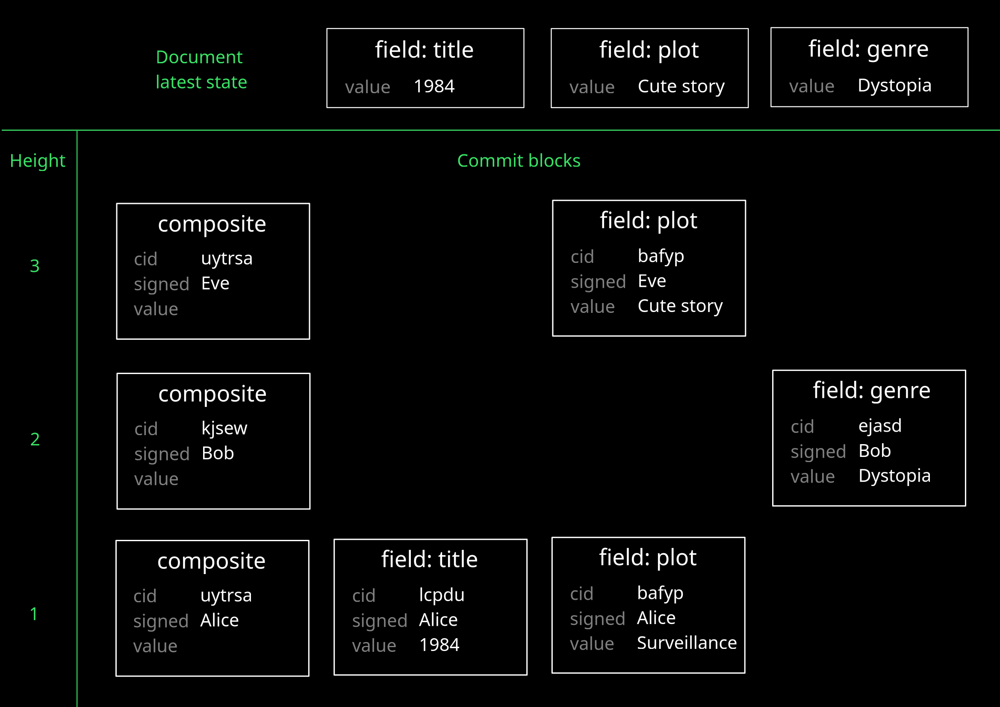

DefraDB's data model is based on MerkleCRDTs. Each document has a graph of all of its updates, similar to Git. The updates are called `commit`s and are identified by `cid`s (content identifiers). Each commit references its parents by their `cid`s.



<details>
  <summary>Display database setup</summary>

  To reproduce the example results from this page, your database needs the following setup.

  ```graphql title="Database schema" test-setup-collection
  type Book {
    title: String!
    genre: String
    plot: String
  }
  ```
</details>

## Query for commits (`_commits` queries) {/* #_commits-queries*/ }

### Syntax {/* #_commits-syntax*/}

<Tabs groupId="commits-syntax">
  <TabItem value="commits-query" label="_commits query" default>
    ```graphql
    query {
      _commits(
        docID: ID, cid: [ID], filter: CommitsFilterArg, depth: Int, limit: Int, offset: Int,
        collectionVersionId: String, order: [commitsOrderArg], groupBy: [commitFields]
      ) [Commit]
    }
    ```

    - `cid` &ndash; Unique identifier of one (or more) commit.
    - `collectionVersionId` &ndash; ID of the [collection](schema/collections.md) version that the commit targeted. Allows you to determine the state of the data model when the change was committed.
    - `depth` &ndash; Position within the chain of commits this one commit is located at (counting from the latest commit). Commits at levels _up to_ the given depth are included. `-1` returns blocks at any depth.
    - `docID` &ndash; ID of document involved in the commits.
    - `filter` &ndash; Restrict which commit blocks to retrieve. See [filter](#filter)
    - `groupBy` &ndash; Organize returned commits into groups. See [DQL -> Group results](dql/group.md) for usage.
    - `limit` &ndash; Maximum number of commits to return.
    - `offset` &ndash; Number of commits to skip from the return list (pagination).
  </TabItem>
  <TabItem value="commits-obj" label="Commit object">
    ```graphql
    type Commit {
      docID: ID
      cid: ID
      delta: String
      height: Int
      fieldName: String
      collectionVersionId: String
      links(docID, cid, filter, groupBy, order): [Commit]
      heads(docID, cid, filter, groupBy, order): [Commit]
      signature: Signature
    }
    ```

    - `cid` &ndash; Unique identifier of a commit.
    - `collectionVersionId` &ndash; ID of the [collection](schema/collections.md) version that the commit targeted. Determines the state of the data model when the change was committed.
    - `docID` &ndash; ID of document involved in the commits.
    - `delta` &ndash; base64 encoded CBOR payload value (the _content_ of the commit).
    - `fieldName` &ndash; Name of the field that this commit was committed against. The value is `"_C"` for composite blocks and null for collection blocks.
    - `heads` &ndash; Parent commits in the DAG that build the history of this piece of data. Linked blocks are at different depths, and of the same type.
    - `height` &ndash; Location of the commit in the DAG (counting from the root commit). All commits from _add_ operations have a height of `1`;  subsequent local _update_ increments the counter by one for the new commits.
    - `links` &ndash; Child commits in the DAG that contribute to the composition of this commit. Linked blocks are at the same depth, and of different types. Composite commits link to the field commits for the fields that the mutation altered; collection commits link to composite commits.
    - `signature` &ndash; Commit's signature. Used to verify the commit's integrity. See [signature](security/signatures.md).
  </TabItem>
</Tabs>


### Commits on document creation {/* #_commits-doc-create */}

Create a new document to observe what commits this generates.

```graphql
mutation {
  add_Book(input: {
    title: "1984",
    plot: "A masterpiece of rebellion and imprisonment where war is peace, freedom is slavery, and Big Brother is watching."
  }) { _docID title }
}
```
```json result
{
  "data": {
    "add_Book": [
      {
        "_docID": "bae-53e80819-b7b4-5fc4-a681-b183b64a8262",
        "title": "1984"
      }
    ]
  }
}
```

To retrieve the commits that resulted from the document creation, use a `_commits` query with the ID of the document.

In this case, there are three commit blocks: two are for the individual fields `title` and `plot`; the third is the composite (`_C`) block, which references the field blocks through the `links` list. You can think of the composite block as a directory containing files. Each commit is uniquely identified by its `cid` field, with the `delta` field containing the data payload that was saved into the storage. In this first layer, all blocks are [signed](security/signatures.md) by the identity which submitted the query.

```graphql
query {
  _commits(docID: "bae-53e80819-b7b4-5fc4-a681-b183b64a8262") {
    fieldName
    cid
    delta
    height
    links {
      cid
      fieldName
    }
    heads {
      cid
      fieldName
    }
    signature {
      identity
      type
      value
    }
  }
}
```
```json result
{
  "data": {
    "_commits": [
      {
        "cid": "bafyreigfmpvezc4efqf27qjlmdvhoiewjbzzfhbphrjcbn5np3azgys3pa",
        "delta": "eHBBIG1hc3RlcnBpZWNlIG9mIHJlYmVsbGlvbiBhbmQgaW1wcmlzb25tZW50IHdoZXJlIHdhciBpcyBwZWFjZSwgZnJlZWRvbSBpcyBzbGF2ZXJ5LCBhbmQgQmlnIEJyb3RoZXIgaXMgd2F0Y2hpbmcu",
        // highlight-next-line
        "fieldName": "plot",
        "heads": [],
        "height": 1,
        "links": [],
        "signature": {
          "identity": "023531430d1053f4eeab4bf520522186698d7e16d53cf0e80df35a158c7a74261e",
          "type": "ES256K",
          "value": "MEUCIQDd0qjbTLAWH2egv3qMKE7afW8O/Ki1Wgum2bwBP/ziHAIgBBtDcYgqdBCUs1P+pV2ZYr/awSd10FkXiGCPKCDk944="
        }
      },
      {
        "cid": "bafyreifeswomzh7doh34t6pcukrktrf4vimazuf32uywrststovczq45ua",
        "delta": "ZDE5ODQ=",
        // highlight-next-line
        "fieldName": "title",
        "heads": [],
        "height": 1,
        "links": [],
        "signature": {
          "identity": "023531430d1053f4eeab4bf520522186698d7e16d53cf0e80df35a158c7a74261e",
          "type": "ES256K",
          "value": "MEUCIQD+lDOW0s823sHqR0BSOTXirlQNAqgsE1nHf2EIgNaLdAIgQ/K+kUExpeu8B9He1Mt2mS4dJB8Qu+Ux07/Xg9Ce6CE="
        }
      },
      {
        "cid": "bafyreidgr7rwyheskxqrmm6lwfacgc7vbiukenv2ppah562avd25rljkcu",
        "delta": null,
        // highlight-next-line
        "fieldName": "_C",
        "heads": [],
        "height": 1,
        "links": [
          {
            "cid": "bafyreifeswomzh7doh34t6pcukrktrf4vimazuf32uywrststovczq45ua",
            "fieldName": "title"
          },
          {
            "cid": "bafyreigfmpvezc4efqf27qjlmdvhoiewjbzzfhbphrjcbn5np3azgys3pa",
            "fieldName": "plot"
          },
        ],
        "signature": {
          "identity": "023531430d1053f4eeab4bf520522186698d7e16d53cf0e80df35a158c7a74261e",
          "type": "ES256K",
          "value": "MEQCIF+kaBWv+EBm4148UXrAmDICrMqBOe0fsaVedfG4ugZBAiA8VenGRQdlp8oGqr+0pZ90VhgDgRwG5mnNY0KRc237LA=="
        }
      }
    ]
  }
}
```

### Commits on document update {/* #_commits-doc-update */}

When a document is updated or deleted, its commits blocks are not updated. Written commits remain unaltered (unless the document is [truncated](dql/mutation-delete.md#truncate), in which case all corresponding blocks are removed) and _more commits_ are appended to the old ones, creating a history of changes that leads to the present moment. These commit blocks create a _Directed Acyclic Graph (DAG)_. The latest version of each document is cached, so the database never has to read through the history chain to build the present version of the data: the latest version is just the tip of such history.

Update the previous document, adding a value for the field `genre`.

```graphql
mutation {
  update_Book(
    docID: "bae-53e80819-b7b4-5fc4-a681-b183b64a8262",
    input: {
      genre: "Dystopia"
    }
  ) { _docID title }
}
```
```json result
{
  "data": {
    "update_Book": [
      {
        "_docID": "bae-53e80819-b7b4-5fc4-a681-b183b64a8262",
        "title": "1984"
      }
    ]
  }
}
```

To retrieve the commits resulting from the update mutation, pick the latest composite and fetch its linked blocks. The result shows the field block for `genre` connected to the returned top composite block, and the previous composite block in the history referenced in the `heads` list. 

Blocks for the same field name at different heights build a history chain via their `heads`, each new one referencing the previous one via its `cid`. Because the `cid` is a cryptographically secure value (the hash of the whole block), the structure of the chain guarantees data integrity by itself: if any part of the data was tampered, the history chain would become invalid.

```graphql
query {
  _commits(
    docID: "bae-53e80819-b7b4-5fc4-a681-b183b64a8262", 
    filter: { fieldName: { _eq: "_C" } },
    depth: 1
  ) {
    fieldName
    cid
    height
    links {
      cid
      fieldName
      delta
    }
    heads {
      cid
      fieldName
    }
  }
}
```
```json result
{
  "data": {
    "_commits": [
      {
        "cid": "bafyreidapjfuskkddbuu5eevkf5usgv6biot7dqlmxau7g5copqr2ax6ha",
        "fieldName": "_C",
        "heads": [
          {
            "cid": "bafyreidgr7rwyheskxqrmm6lwfacgc7vbiukenv2ppah562avd25rljkcu",
            "fieldName": "_C"
          }
        ],
        "height": 2,
        "links": [
          {
            "cid": "bafyreihqf7xoxfeqpukhzlrat3quh6qajm7zjbkvrrqvbw6poaohhqdow4",
            "delta": "aER5c3RvcGlh",
            "fieldName": "genre"
          }
        ]
      }
    ]
  }
}
```

:::tip
The example above queries for the top composite blocks and fetches its links. This ensures that only blocks created as result of the latest database operation are returned.

It can feel natural to query for commits at `depth: 1`. This type of query makes sense to get a view of the _latest state_ of the document, as it returns the top layer for blocks of all types, regardless of their `height` value.

```graphql
query {
  _commits(docID: "bae-1da55608-e747-572b-8271-2ef35b66520d", depth: 1) {
    fieldName
    height
  }
}
```
```json result
{
  "data": {
    "_commits": [
      {
        "fieldName": "genre",
        "height": 2
      },
      {
        "fieldName": "plot",
        "height": 1
      },
      {
        "fieldName": "title",
        "height": 1
      },
      {
        "fieldName": "_C",
        "height": 2
      }
    ]
  }
}
```

In the example, `genre` was updated in the second query and has `height: 2` (corresponding to `depth: 1`). On the other hand, `title` and `plot` were not changed in the second query and have `height: 1`, and they are surfaced when querying for `depth: 1` because there are no blocks on top of them.
:::

## Filter commits {/* #filter */}

You can restrict the commits result to a subset via the `filter` argument to `_commits` queries.

- [Single filter](#filter-single) &ndash; Restrict blocks to a specific field name (or composite/collection blocks).
- [Composite filter](#filter-composite) &ndash; Restrict blocks to an `and`/`or` combination of fields.

### Single filter {/* #filter-single */}

```text title="Syntax"
filter: {
  fieldName: {
    <scalar-operator>: <field>
  }
}
```

- `<scalar-operator>` &ndash; Operator to use for comparison. Supported values: `_eq`, `_neq`, `_in`, `_nin`. For more information, see [DQL -> Filter operators](dql/filter.md#scalar-operators).
- `<field>` &ndash; Field value to filter against (`_C` for composite blocks).

```graphql title='Retrieve only composite blocks at certain depth'
query {
  _commits(
    docID: "bae-1da55608-e747-572b-8271-2ef35b66520d",
    depth: 1,
    # highlight-next-line
    filter: { fieldName: { _eq: "_C" } }
  ) {
    fieldName
    cid
    height
  }
}
```
```json result
{
  "data": {
    "_commits": [
      {
        "cid": "bafyreicwrhqj2hffnukwgsgabn6kvt3ugselh3jopj3hjn2h6r6jjddb7y",
        "fieldName": "_C",
        "height": 3
      }
    ]
  }
}
```

```graphql title='Retrieve only blocks for field "title" at certain depth'
query {
  _commits(
    docID: "bae-1da55608-e747-572b-8271-2ef35b66520d",
    depth: 1,
    # highlight-next-line
    filter: { fieldName: { _eq: "title" } }
  ) {
    fieldName
    cid
    height
  }
}
```
```json result
{
  "data": {
    "_commits": [
      {
        "cid": "bafyreiaop4astmiumafndbxyxfba7n4nnkvdig6khhhs6ahd6mog3fklxi",
        "fieldName": "title",
        "height": 2
      }
    ]
  }
}
```

### Composite filter {/* #filter-composite */}

```text title="Syntax"
filter: {
  <logical-operator>: [
    {
      fieldName: {
        <scalar-operator>: <value>
      }
    }, 
    ...
  ]
}
```

- `<logical-operator>` &ndash; Logical operator to combine the list of field conditions. Supported values: `_or`, `_and`.
- `<scalar-operator>` &ndash; Operator to use for comparison. Supported values: `_eq`, `_neq`, `_in`, `_nin`. For more information, see [DQL -> Filter operators](dql/filter.md#scalar-operators).
- `<field>` &ndash; Field value to filter against (`_C` for composite blocks).

```graphql title='Retrieve blocks for field "title" or "plot" at certain depth'
query {
  _commits(
    docID: "bae-1da55608-e747-572b-8271-2ef35b66520d",
    depth: 1,
    # highlight-next-line
    filter: { _or: [{ fieldName: { _eq: "title" } }, { fieldName: { _eq: "plot" } }] }
  ) {
    fieldName
    cid
    height
  }
}
```
```json result
{
  "data": {
    "_commits": [
      {
        "cid": "bafyreifgevb75flatgzvwgz5qgq6c3mb5i3sh6lw47lhkka5vv2ptkqlbe",
        "fieldName": "plot",
        "height": 2
      },
      {
        "cid": "bafyreiaop4astmiumafndbxyxfba7n4nnkvdig6khhhs6ahd6mog3fklxi",
        "fieldName": "title",
        "height": 2
      }
    ]
  }
}
```

## Get document or field at specific commit {/* #query-by-cid */}

To retrieve a document from a previous state, get the `cid` of the composite block referencing that state, and use it to query the document type.

```graphql title='Get document in the state it was at the given (composite) commit ID'
query {
  Book(cid: "bafyreidgr7rwyheskxqrmm6lwfacgc7vbiukenv2ppah562avd25rljkcu") { 
    title
    plot
  }
}
```
```json result
{
  "data": {
    "Book": [
      {
        "plot": "A masterpiece of rebellion and imprisonment where war is peace, freedom is slavery, and Big Brother is watching.",
        "title": "1984"
      }
    ]
  }
}
```

:::note
You can also use the commit ID of a field block, but information about other fields won't be shown. For example, querying `Book` with a `cid` relating to an update for `title` shows the field `plot` has value `null`. To include the state of all fields, use the composite commit at the same height.

```graphql title='Get document state using cid for a specific field'
query {
  Book(cid: "bafyreifeswomzh7doh34t6pcukrktrf4vimazuf32uywrststovczq45ua") { 
    title
    plot
  }
}
```
```json result
{
  "data": {
    "Book": [
      {
        "plot": null,
        "title": "1984"
      }
    ]
  }
}
```
:::

## Get commit history for a document {/* #query-commits-for-doc-type */}

Include the `_version` sub-object in the return set to retrieve the document commit history. The whole commit chain is surfaced in this way, although it only includes composite blocks (from which you can return the related field commits by returning its `links`).

```graphql title='Retrieve document and its commit history'
query {
  Book { 
    title
    _version {
      cid
      fieldName
      links {
        fieldName
        delta
      }
    }
  }
}
```
```json result
{
  "data": {
    "Book": [
      {
        "_version": [
          {
            "cid": "bafyreicwrhqj2hffnukwgsgabn6kvt3ugselh3jopj3hjn2h6r6jjddb7y",
            "fieldName": "_C",
            "links": [
              {
                "delta": "ZDE5ODU=",
                "fieldName": "title"
              },
              {
                "delta": "cUEgY2hlZXJmdWwgc3Rvcnku",
                "fieldName": "plot"
              }
            ]
          },
          {
            "cid": "bafyreidapjfuskkddbuu5eevkf5usgv6biot7dqlmxau7g5copqr2ax6ha",
            "fieldName": "_C",
            "links": [
              {
                "delta": "aER5c3RvcGlh",
                "fieldName": "genre"
              }
            ]
          },
          {
            "cid": "bafyreidgr7rwyheskxqrmm6lwfacgc7vbiukenv2ppah562avd25rljkcu",
            "fieldName": "_C",
            "links": [
              {
                "delta": "ZDE5ODQ=",
                "fieldName": "title"
              },
              {
                "delta": "eHBBIG1hc3RlcnBpZWNlIG9mIHJlYmVsbGlvbiBhbmQgaW1wcmlzb25tZW50IHdoZXJlIHdhciBpcyBwZWFjZSwgZnJlZWRvbSBpcyBzbGF2ZXJ5LCBhbmQgQmlnIEJyb3RoZXIgaXMgd2F0Y2hpbmcu",
                "fieldName": "plot"
              },
              {
                "delta": "aER5c3RvcGlh",
                "fieldName": "genre"
              }
            ]
          }
        ],
        "title": "1985"
      }
    ]
  }
}
```

+ remark on cached latest state
+ trace backward to root, replay forward

Time travelling queries return a single document's historical state. They cannot automatically include related documents at that same point in time.
